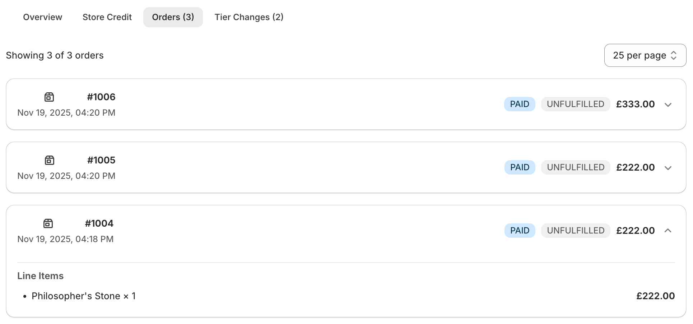

# Customer Details

## Overview

<figure><figcaption></figcaption></figure>

* **Customer Information card**: shows name/email, Shopify customer ID, live store credit balance with currency formatting, and the created/updated timestamps so agents can quickly validate recency before acting.
* **Tier Details card**: when a tier exists, the overview includes a secondary card outlining cashback rate, minimum spend, and evaluation period to help teams justify overrides or explain benefits on a call.

***

## Store Credit

<figure><figcaption></figcaption></figure>

* **Current balance panel**: mirrors the store credit value shown in the overview but anchors the amount with tone and currency formatting plus quick action buttons (issue credit, deduct credit) so CX agents can take action without leaving the modal.
* **Transaction table**: lists ledger entries with tone-coded badges (`Cashback`, `Payment`, `Refund`, `Adjustment`, `Sync`), amounts, order references, and timestamps, helping finance and CX teams audit history at a glance.

***

## Orders

<figure><figcaption></figcaption></figure>

* **Order list cards**: each order renders with order name, creation timestamp, and badges for financial plus fulfillment status, alongside the grand total so agents can instantly qualify the request.
* **Collapsible line items**: a chevron button reveals the order’s line items using a divider, header, and bulleted list that breaks down quantity and per-line totals—ideal for reconciling disputes without leaving the modal.

***

## Tier Changes

<figure><figcaption></figcaption></figure>

* **Change timeline cards**: each tier change is rendered with a change type (e.g., manual override, upgrade), and timestamp so CX, loyalty, and finance teams can see what happened and when.
* **Badge transitions**: badges display `from` and `to` tier names with an arrow between them, highlighting whether a shift was an upgrade or downgrade at a glance.
* **Notes & context**: optional notes, trigger types (e.g., automation, manual), and total spend data appear in subdued text beneath the badges, giving auditors enough context to validate eligibility or detect anomalies.
