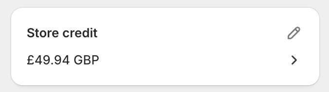
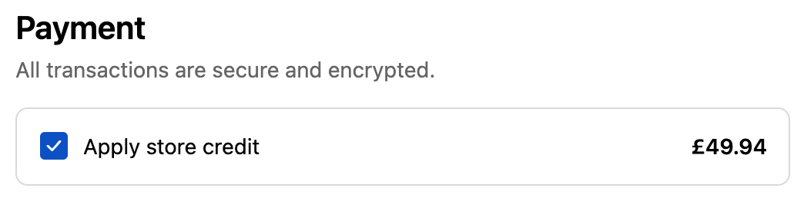
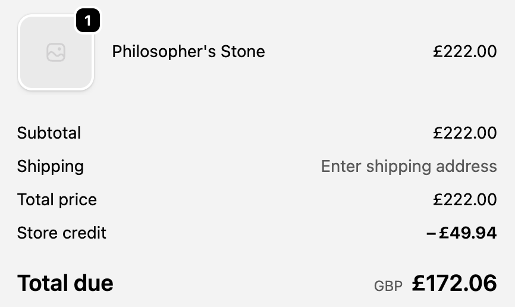

# Access Store Credits

Shopify **Store Credit** is an internal balance that a merchant issues to a customer, stored directly in Shopify’s **Customer Account**. It functions like a wallet inside Shopify and can be applied at checkout as a payment method.

## VIP status

<figure><figcaption></figcaption></figure>

VIP status is displayed as a widget in the customer facing storefront, with display of tier, cashback percentage, store credit balance, and tier progress.

## Merchants's customer portal

<figure><figcaption></figcaption></figure>

### Customer-level balance

Store credit is stored on the _Customer_ resource, not at the order level. Each customer has a StoreCreditAccount with a running balance.

Store credit balance can be accessed through shopify's customer portal.

### Ledger based

<figure><figcaption></figcaption></figure>

All changes are made through **store credit adjustments** (credit or debit entries). These form a ledger:

* **Credit** = add value (refunds, goodwill, loyalty rewards).
* **Debit** = subtract value (customer redeems store credit at checkout).

## Customer Checkout

<figure><figcaption></figcaption></figure>

Customer can apply their store credit balance during checkout by selecting the store credit option under Payment module

<figure><figcaption></figcaption></figure>

The store credit balance will be deducted from the total purchasing price automatically
