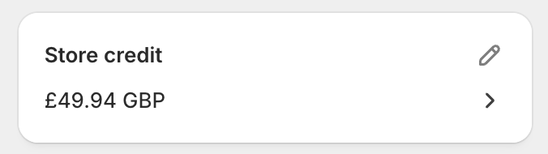
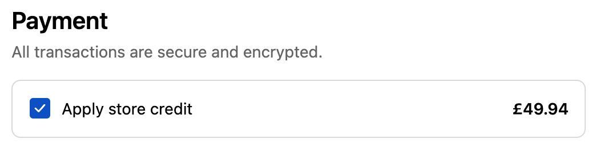
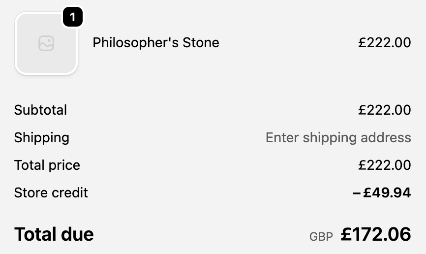

# Access Store Credits

Store credit is a balance held in a customer's account that can be applied toward purchases. RewardsPro integrates with Shopify's native store credit system for seamless checkout experiences.

## What is Store Credit?

Store credit is:
- A balance on the customer's Shopify account
- Earned through cashback on purchases
- Can be added manually by merchants
- Usable as payment at checkout
- Tracked with complete transaction history

---

## Customer Access Points

### 1. VIP Status Widget

<figure><figcaption>Customers see their status and balance in the storefront widget</figcaption></figure>

The customer-facing widget displays:

| Element | Description |
|---------|-------------|
| **Tier Badge** | Current loyalty tier with icon |
| **Cashback Rate** | Percentage they earn on orders |
| **Store Credit** | Current available balance |
| **Progress** | Progress toward next tier |

**Widget Location:**
- Floating button on storefront
- Opens to show full status
- Updates in real-time

### 2. Merchant's Customer Portal

<figure><figcaption>Store credit visible in customer account pages</figcaption></figure>

**Customer-level balance:**
- Stored on the Customer resource in Shopify
- Each customer has a StoreCreditAccount
- Running balance updated with each transaction

**Accessed through:**
- Shopify customer account pages
- Order confirmation emails (if configured)
- Account dashboard

### 3. Transaction Ledger

<figure><figcaption>Complete history of credit and debit entries</figcaption></figure>

All changes are recorded as **ledger entries**:

| Entry Type | Direction | Examples |
|------------|-----------|----------|
| **Credit** | + Add | Cashback, refunds, promotions |
| **Debit** | - Subtract | Checkout redemption |

**Ledger benefits:**
- Complete audit trail
- Transparent to customers
- Useful for disputes
- Required for accounting

---

## Using Store Credit at Checkout


**Who can spend store credit**: Shopify lets customers spend store credit at checkout only when signed in through customer accounts, or when paying with Shop Pay. Store credit isn't available with legacy customer accounts. See [Installation](../getting-started/installation.md) for Shopify's rules and its fee on store credit.


### Step 1: View Available Credit

<figure><figcaption>Store credit appears as a payment option</figcaption></figure>

At checkout, customers see:
- Available store credit balance
- Option to apply credit
- Remaining balance after use

### Step 2: Apply Credit

<figure><figcaption>Credit is automatically deducted from total</figcaption></figure>

**How Shopify applies it:**
- Shopify applies the customer's full store credit balance
- Customers can't choose a partial amount
- The rest of the order is paid another way

**What happens:**
1. Customer clicks "Apply Store Credit"
2. Amount deducted from order total
3. Remaining paid by card/other method
4. Balance updated immediately

---

## Balance Display

### In Widget

```
┌─────────────────────────┐
│ 💰 Store Credit         │
│                         │
│      $45.50             │
│    Available Balance    │
│                         │
└─────────────────────────┘
```

### In Account

Store credit shows natively in Shopify customer accounts. Signed-in customers see their balance there. Legacy customer accounts don't show store credit.

### In Checkout

During checkout:
- Balance available to apply
- Clear apply/remove buttons
- Updated total after applying

---

## Currency Handling

### Store Currency

- RewardsPro issues cashback as store credit in your store currency
- Displayed in store currency format
- Proper symbol and decimal handling

### Multi-Currency Stores

Shopify shows a customer only the store credit balance that matches the currency of their checkout. A customer checking out in another currency won't see store credit issued in your store currency.

---

## Best Practices

### For Merchants

✅ **Do:**
- Make balance visible in widget
- Remind customers of credit in emails
- Train support on credit inquiries
- Monitor outstanding balances

❌ **Don't:**
- Hide credit information
- Make redemption difficult
- Forget to sync balances
- Ignore credit disputes

### For Customer Experience

- **Visibility**: Ensure customers can easily see their balance
- **Reminders**: Email about unused credit periodically
- **Ease of Use**: One-click apply at checkout
- **Transparency**: Show how credit was earned

---

## Troubleshooting

### Customer Can't See Balance

1. Verify they're logged in
2. Check widget is enabled
3. Confirm balance exists
4. Clear browser cache

### Balance Not Updating

1. Check for processing delays
2. Verify order was paid
3. Review transaction history
4. Sync with Shopify if needed

### Can't Apply at Checkout

1. Check the customer is signed in through customer accounts, or paying with Shop Pay
2. Check your store doesn't use legacy customer accounts (**Shopify Admin** → **Settings** → **Customer accounts**)
3. Check the checkout currency matches the currency of the customer's balance
4. Store credit can't pay for draft orders, edited orders or recurring subscription payments
